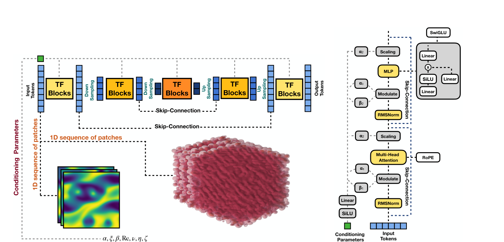

# Simplifying Transformer-Based U-Net Neural Physics Simulators

**Pietro Sittoni**<sup>1</sup>, **Francesco Tudisco**<sup>1,2,3</sup><br>
<sup>1</sup>Gran Sasso Science Institute &nbsp; <sup>2</sup>University of Edinburgh &nbsp; <sup>3</sup>Miniml.AI

*NeurIPS 2026* · [Citation](#citation)
<!-- TODO: add the arXiv / OpenReview link once available. -->

Official PyTorch implementation of **UFlex**, an attention-based U-Net that operates on a 1D token sequence. The same model handles 1D, 2D, 3D and spatiotemporal regular-grid problems.

<p align="center">
  
</p>

- **U-Net on tokens:** learnable down/upsampling merges or splits `f = 4` consecutive tokens; additive skip connections.
- **Standard Transformer blocks:** self-attention with RoPE, SwiGLU MLP, RMSNorm.
- **Physics conditioning:** scalar parameters are embedded and injected with adaRMSN-Zero.
- **Shape-agnostic:** resolution, number of input frames and 2D vs. 3D are read from the input.
- **Causal in time, global in space:** with several input frames, tokens attend only to their own frame and earlier frames.

## Installation

```bash
git clone https://github.com/Pietrosittoni/UFlex.git
cd UFlex
pip install -r requirements.txt
```

Tested with Python 3.11, PyTorch 2.7 and CUDA 12.6.

## Data

Configs read data from `data_path`, under `data/` by default.

```bash
# The Well: active_matter, planetswe, viscoelastic_instability, rayleigh_taylor_instability, convective_envelope_rsg
the-well-download --base-path data/the_well --dataset active_matter

# PDEBench: 2D and 3D compressible Navier–Stokes
python scripts/download_pdebench.py --root_folder data/pdebench --pde_name 2d_cfd --pde_name 3d_cfd

# DiffusionPDE: static problems (darcy, helmholtz, ...)
scripts/download_diffusionpde.sh data/diffusionpde darcy helmholtz
```

## Training

```bash
python train.py --config configs/active_matter/uflex_b.yaml
```

`configs/<benchmark>/` contains `uflex_s.yaml`, `uflex_b.yaml` and `uflex_l.yaml`. The benchmarks are `active_matter`, `planetswe`, `viscoelastic_instability`, `cns_2d`, `cns_3d`, `rayleigh_taylor_instability` and `convective_envelope_rsg`. After training, `train.py` evaluates autoregressive rollouts on the test set and saves `checkpoints/<run>/model.pt`. Logging uses Weights & Biases; set `WANDB_MODE=disabled` to turn it off.

```bash
# 2D -> 3D transfer: fine-tune a pretrained backbone (set pretrained_checkpoint in the config)
python finetune.py --config configs/cns_3d_finetune/uflex_b.yaml

# Static prediction: initial condition -> state after `horizon` steps
python train_steady_state.py --config configs/active_matter_steady/uflex_b.yaml
```

## Evaluation

```bash
python plot_rollout.py --config configs/planetswe/uflex_b.yaml --checkpoint checkpoints/<run>/model.pt
python benchmark.py --config configs/active_matter/uflex_b.yaml --input-shape 1 256 256 11
```

## Usage

```python
import torch
from uflex import UFlex

model = UFlex(in_channels=4, patch_size=(8, 8), num_parameters=1)  # (8, 8, 8) for 3D

x = torch.randn(2, 4, 256, 256, 4)       # (batch, frames, H, W, fields)
params = torch.tensor([[0.1], [1.0]])    # (batch, num_parameters)
next_frame = model(x, params)            # (2, 1, 256, 256, 4)
```

| Size | `heads` | `heads_middle` | `depth_res` | `depth_middle` | Parameters |
|---|---|---|---|---|---|
| UFlex-S | `[6, 8]` | 12 | 2 | 2 | 57M |
| UFlex-B (default) | `[8, 12]` | 18 | 2 | 2 | 123M |
| UFlex-L | `[12, 16]` | 24 | 3 | 4 | 374M |

Each spatial size must be divisible by the patch size, and the patches per frame must be divisible by `downsampling_factor ** depth`. All arguments are documented in [`uflex/model.py`](uflex/model.py).

## Tests

```bash
pytest tests
```

## Citation

```bibtex
@inproceedings{sittoni2026uflex,
  title     = {Simplifying Transformer-Based U-Net Neural Physics Simulators},
  author    = {Sittoni, Pietro and Tudisco, Francesco},
  booktitle = {Advances in Neural Information Processing Systems},
  year      = {2026}
}
```

## Acknowledgements

Data from [The Well](https://github.com/PolymathicAI/the_well), [PDEBench](https://github.com/pdebench/PDEBench) and [DiffusionPDE](https://huggingface.co/datasets/jcy20/DiffusionPDE-normalized). Conditioning adapted from [DiT](https://github.com/facebookresearch/DiT); rotary embeddings from [rotary-embedding-torch](https://github.com/lucidrains/rotary-embedding-torch).
